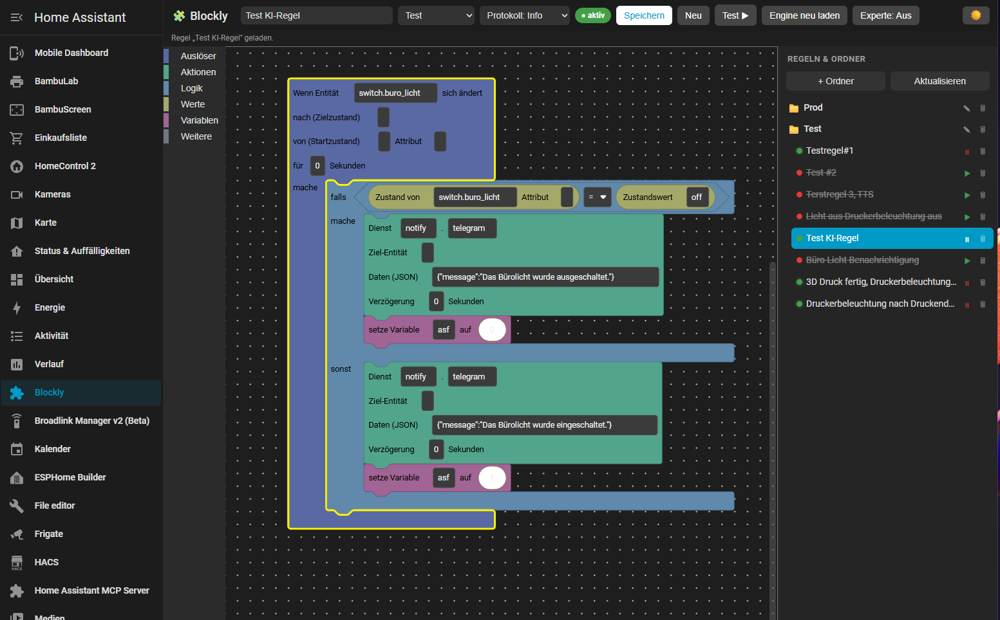

<p align="center">
  
</p>

# HA Blockly Automations

Ein visueller Automatisierungs-Editor für **Home Assistant** auf Basis von
[Blockly](https://developers.google.com/blockly) – inspiriert von der
Blockly-Oberfläche in ioBroker. Die Erweiterung integriert sich als eigener
Eintrag **„Blockly“ in der linken Seitenleiste**, speichert Regeln in einer
**Ordnerstruktur auf der rechten Seite** und bringt einen **KI-Editor** mit,
der aus einer Texteingabe über die in Home Assistant eingebundenen
LLM-/Konversationsagenten ein fertiges Blockly-Setup erzeugt.



## Funktionen

- 🧩 **Visueller Editor** in der Seitenleiste – Blöcke per Drag & Drop
  verbinden, genau wie in ioBroker.
- ⚙️ **Eigene Laufzeit**: Regeln werden nicht in HA-Automationen übersetzt,
  sondern von einer eigenen Engine interpretiert, die Auslöser am Event-Bus
  registriert und Aktionen als Dienstaufrufe ausführt.
- 📁 **Ordnerstruktur** rechts im Panel zum Organisieren der Regeln
  (anlegen, umbenennen, löschen, verschachteln).
- 🤖 **KI-Editor**: Beschreibe die Automatisierung in natürlicher Sprache,
  wähle einen Konversationsagenten (OpenAI, Anthropic, Google, lokales Ollama …
  – je nachdem, was in HA eingerichtet ist) und lass daraus editierbare Blöcke
  generieren.
- 💾 Persistente Speicherung über den HA-Storage-Helfer.
- ▶️ Regeln einzeln aktivieren/deaktivieren und testweise ausführen.

## Installation über HACS

1. HACS öffnen → **Integrationen** → Menü oben rechts → **Benutzerdefinierte
   Repositories**.
2. Repository-URL eintragen: `https://github.com/xCite1986/ha_blockly`
   – Kategorie: **Integration**.
3. **HA Blockly Automations** installieren und Home Assistant neu starten.
4. **Einstellungen → Geräte & Dienste → Integration hinzufügen →
   „HA Blockly Automations“**.
5. In der linken Seitenleiste erscheint der Eintrag **Blockly**.

### Manuelle Installation

Ordner `custom_components/ha_blockly` in das `config/custom_components/`-
Verzeichnis kopieren und Home Assistant neu starten, dann die Integration
hinzufügen.

## Bedienung

- **Links**: Werkzeugkasten mit den Block-Kategorien *Auslöser, Aktionen,
  Logik, Werte, Variablen* und der Arbeitsfläche.
- **Rechts**: Ordner- und Regelbaum sowie der KI-Editor.
- Oben: Regelname, Zielordner, **Speichern**, **Neu**, **Test ▶**,
  **Engine neu laden**.

Eine Regel besteht aus einem **Auslöser-Block** (z. B. „Wenn Entität …
sich ändert“) mit einem **mache**-Stapel aus Aktionen. Beim Speichern wird die
Arbeitsfläche in eine kleine JSON-Zwischenrepräsentation (IR) übersetzt, die die
Engine ausführt.

### Beispiel (analog zum Heizungs-Screenshot)

- Auslöser: *Wenn Entität `input_select.heizung_schlafzimmer` sich ändert*
- `falls` Zustand von `input_select.heizung_schlafzimmer` `=` `"0"` →
  *Dienst `climate.set_temperature` auf `climate.schlafzimmer`, Daten
  `{"temperature": 12}`*
- usw.

## KI-Editor

Der KI-Editor nutzt die **Conversation-Integration** von Home Assistant. Es
funktioniert jeder dort eingerichtete Agent mit LLM-Backend. Der Agent erhält
eine Beschreibung der IR und eine Liste der verfügbaren Entitäten und liefert
ein JSON-Programm zurück, das der Editor in Blöcke umwandelt. Prüfe das Ergebnis
immer, bevor du es speicherst.

> Standard-Agent bzw. Agent-ID lassen sich in den Optionen der Integration
> voreinstellen.

## IR-Schema (für Entwickler)

Die Engine (`engine.py`) interpretiert folgendes JSON:

```jsonc
{
  "version": 1,
  "triggers": [
    { "type": "state", "entity": "binary_sensor.x", "to": "on", "for": 30 },
    { "type": "time", "at": "07:00:00" },
    { "type": "event", "event_type": "my_event" },
    { "type": "ha_start" }
  ],
  "actions": [
    { "type": "service", "domain": "light", "service": "turn_on",
      "target": { "entity_id": "light.x" }, "data": { "brightness": 255 },
      "delay": 0 },
    { "type": "if", "condition": { "type": "compare",
        "left": { "type": "state", "entity": "sensor.t" },
        "op": ">", "right": { "type": "const", "value": 20 } },
      "then": [], "else": [] },
    { "type": "set_var", "name": "x", "value": { "type": "const", "value": 1 } },
    { "type": "wait", "seconds": { "type": "const", "value": 5 } },
    { "type": "notify", "service": "notify.notify",
      "message": { "type": "template", "template": "{{ states('sensor.t') }}" } }
  ]
}
```

Die Block→IR-Kompilierung (`frontend/compiler.js`) und das Laden von
KI-Ergebnissen (`frontend/irloader.js`) laufen im Frontend; die Engine bleibt
dadurch klein und sprachunabhängig.

## Einschränkungen / Roadmap

- Variablen gelten pro Durchlauf (nicht global/persistent).
- Mehrere Auslöser-Blöcke pro Regel: nur der Aktionsstapel des **ersten**
  Blocks wird ausgeführt (die übrigen liefern zusätzliche Auslöser).
- Entitätsfelder sind derzeit Texteingaben (Autovervollständigung geplant).
- Kein Import bestehender ioBroker-XML-Skripte.

## Lizenz

MIT – siehe [LICENSE](LICENSE).
